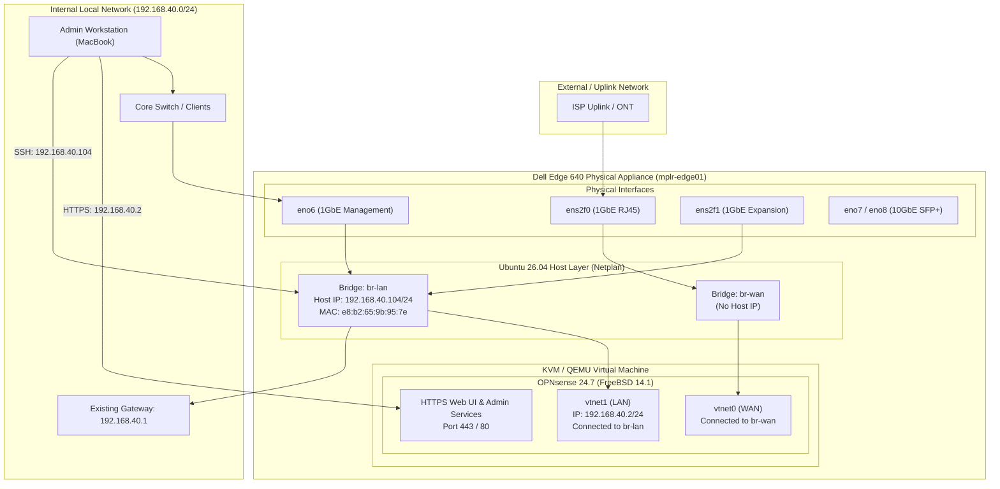

# Dell Edge 640 (`mplr-edge01`) - KVM & OPNsense Edge Router

This directory contains the system documentation, network architecture, and Infrastructure-as-Code configuration for `mplr-edge01`, a Dell EMC Virtual Edge Platform (VEP) 640 running Ubuntu 26.04 LTS with KVM hosting a virtualized OPNsense 24.7 firewall.

---

## 1. Hardware Specifications

| Component | Specification |
| :--- | :--- |
| **Model** | Dell EMC Virtual Edge Platform 640 (VEP640 / Edge 640) |
| **CPU** | Intel Atom C3758 (Denverton) 8 cores @ 2.20 GHz |
| **RAM** | 30 GB DDR4 ECC |
| **Storage** | 240 GB SATA SSD (`/dev/sda`) |
| **Host OS** | Ubuntu 26.04.1 LTS (`x86_64`) |
| **Hypervisor** | KVM / QEMU 8.2+ / Libvirt 10.0+ |
| **Firmware** | UEFI / OVMF 4MB (`/usr/share/OVMF/OVMF_CODE_4M.fd`) |

### Physical Network Interfaces

The Dell Edge 640 features 8 physical network interfaces:
* **4x 1GbE RJ-45 (Intel I350 Gigabit)**: `ens2f0`, `ens2f1`, `ens2f2`, `ens2f3`
* **2x 1GbE RJ-45 (Intel X553 Integrated GbE)**: `eno5`, `eno6`
* **2x 10GbE SFP+ (Intel X553 Integrated 10GbE)**: `eno7`, `eno8`

---

## 2. Architecture Diagram



---

## 3. Host Network Bridging (Netplan)

The host network configuration is located at [`config/01-netcfg.yaml`](file:///Users/stanbrinkerhoff/git/various-infrastructure/mplr-edge01/config/01-netcfg.yaml) and deployed to `/etc/netplan/01-netcfg.yaml` on `mplr-edge01`.

* **Bridge `br-wan`**:
  * Member interface: `ens2f0`
  * No host IP assigned; dedicated as the L2 bridge for OPNsense WAN (`vtnet0`).
* **Bridge `br-lan`**:
  * Member interfaces: `eno6` (uplink cable to physical network) and `ens2f1` (spare physical port).
  * Host IP: `192.168.40.104/24` with default route `192.168.40.1`.
  * Clones `eno6`'s MAC address (`e8:b2:65:9b:95:7e`) to prevent switch MAC churn and ensure DHCP/ARP stability.
  * Connects directly to OPNsense LAN (`vtnet1`).

---

## 4. OPNsense Virtual Machine Specification

The Libvirt domain XML is versioned at [`config/opnsense.xml`](file:///Users/stanbrinkerhoff/git/various-infrastructure/mplr-edge01/config/opnsense.xml).

| Parameter | Configuration |
| :--- | :--- |
| **Domain Name** | `opnsense` |
| **Architecture** | `x86_64` (machine `pc-i440fx-resolute`) |
| **Firmware** | UEFI via OVMF 4M (`/usr/share/OVMF/OVMF_CODE_4M.fd`) |
| **vCPUs** | 4 (host-passthrough mode) |
| **Memory** | 8192 MiB (8 GB) |
| **Disk** | 40 GB QCOW2 (`/var/lib/libvirt/images/opnsense.qcow2`) via `virtio` bus |
| **Network Interfaces** | `vtnet0` on `br-wan` (virtio)<br/>`vtnet1` on `br-lan` (virtio) |
| **Graphics / Display** | VNC on `0.0.0.0:5900` (password: `opnsense`), Bochs VGA |
| **Serial / Console** | Serial PTY (`ttyS0`), accessible via `virsh console` |
| **Boot Behavior** | Autostarts on host boot (`virsh autostart opnsense`) |

---

## 5. Network Addressing & Credentials

### OPNsense VM
* **LAN IPv4**: `192.168.40.2/24`
* **Upstream Gateway**: None (acts as peer/secondary router during staged transition)
* **DHCP Server**: **Disabled** (prevents conflicts with existing router `192.168.40.1`)
* **Web UI**: [https://192.168.40.2/](https://192.168.40.2/)
* **Default Credentials**:
  * Username: `root`
  * Password: `opnsense`
* **VNC Remote Access**: `vnc://192.168.40.104:5900` (macOS Screen Sharing compatible, password: `opnsense`)

### Host System
* **Hostname**: `mplr-edge01`
* **Host IP**: `192.168.40.104/24`
* **SSH Access**: `ssh ubuntu@192.168.40.104` (Passwordless sudo configured)

---

## 6. Post-Installation & Tuning: VirtIO Checksum Offloading

Under FreeBSD / OPNsense running in KVM with VirtIO network interfaces, hardware checksum and segmentation offloading must be disabled to prevent packet drop issues and TCP checksum errors:

1. Navigate to **Interfaces** $\rightarrow$ **Settings** in the OPNsense Web UI.
2. Check the following options:
   * **Disable hardware checksum offload** (`disablechecksumoffloading`)
   * **Disable hardware TCP segmentation offload** (`disablesegmentationoffloading`)
   * **Disable hardware large receive offload** (`disablelargeReceiveoffloading`)
3. Click **Save** and apply the changes.

---

## 7. Operational Runbook

### VM Lifecycle Management
```bash
# Check VM status
virsh dominfo opnsense

# Graceful shutdown
virsh shutdown opnsense

# Force power off
virsh destroy opnsense

# Start VM
virsh start opnsense

# Reboot VM
virsh reboot opnsense

# Enable / verify autostart
virsh autostart opnsense
```

### Accessing the VM Console
* **macOS Screen Sharing (VNC)**:
  ```bash
  open vnc://192.168.40.104:5900
  ```
  *(Enter password `opnsense` when prompted)*

* **Text Serial Console**:
  ```bash
  virsh console opnsense
  ```
  *(Escape character is `Ctrl + ]`)*

### Backup and Restore
1. **OPNsense Configuration**:
   * In Web UI: **System** $\rightarrow$ **Configuration** $\rightarrow$ **Backups** $\rightarrow$ **Download configuration**.
   * Via CLI on host:
     ```bash
     virsh guest-agent commands (if installed) or scp /conf/config.xml
     ```

2. **Full Disk Backup**:
   ```bash
   sudo qemu-img snapshot -c backup-$(date +%F) /var/lib/libvirt/images/opnsense.qcow2
   ```
