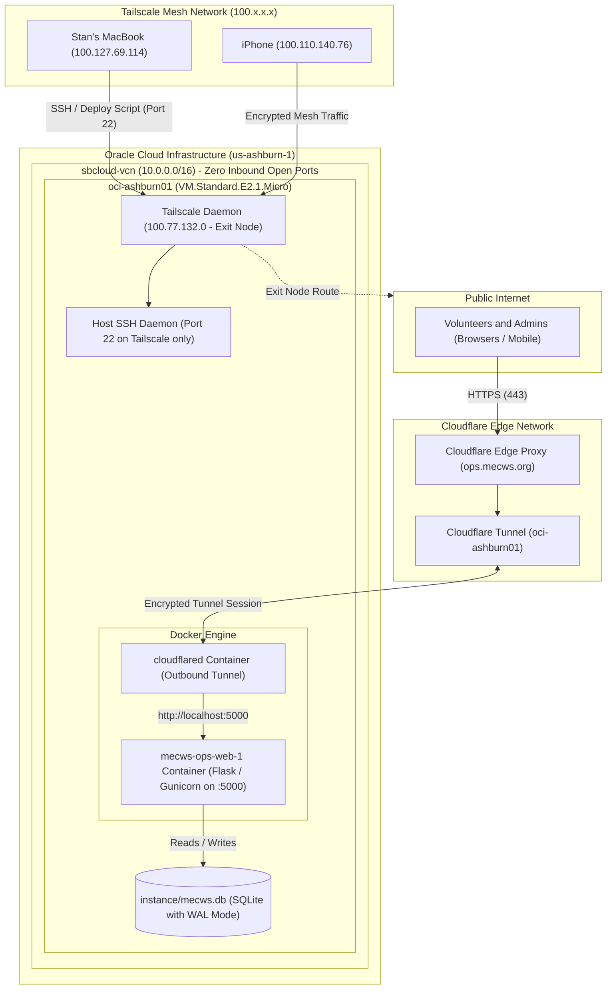

# oci-mecws

Infrastructure as Code (Terraform) and operational documentation for the **sbpersonalcloud** Oracle Cloud Infrastructure (OCI) tenancy in home region `us-ashburn-1` (IAD).

This environment hosts:
1. **`oci-ashburn01`**: An Always-Free AMD micro instance (`VM.Standard.E2.1.Micro`) running the **MECWS Volunteer Operations** application and acting as a **Tailscale Exit Node**.
2. **`sbcloud-a1`**: An Always-Free ARM Ampere instance (`VM.Standard.A1.Flex`) pending host capacity allocation via an automated retry daemon.

---

## Architecture Overview

The system employs a **Zero-Trust network architecture**:
- **Administrative Plane (Tailscale)**: Inbound SSH (port 22) from the public internet is disabled in OCI. Host management, code deployments, and telemetry happen exclusively across the private Tailscale WireGuard mesh.
- **Ingress Plane (Cloudflare Tunnel)**: Public HTTP/HTTPS traffic to `https://ops.mecws.org` is handled by Cloudflare edge servers and forwarded across an outbound encrypted QUIC/HTTP2 tunnel connection directly into Docker. No public ports (80/443) are opened on the OCI firewall, VCN, or host.



---

## System Integrations

### 1. Tailscale Mesh Network

- **Node Name**: `oci-ashburn01`
- **Tailscale IP**: `100.77.132.0`
- **Tailnet Domain**: `oci-ashburn01.tail657922.ts.net`
- **Role**: Secure administrative gateway and exit node.

#### Zero Inbound Public SSH Exposure
The OCI Network Security Group (NSG) `public-ssh` has `public_ssh_micro = false` in Terraform. As a result, the public IP (`157.151.220.214`) completely drops inbound packets on port 22. SSH is accessible strictly via Tailscale:
```bash
ssh ubuntu@oci-ashburn01
# or
ssh ubuntu@100.77.132.0
```

#### Exit Node Configuration
The instance is configured to route traffic for other Tailscale nodes:
- Kernel IP forwarding enabled: `/etc/sysctl.d/99-tailscale.conf` contains:
  ```ini
  net.ipv4.ip_forward = 1
  net.ipv6.conf.all.forwarding = 1
  ```
- Advertised via `tailscale set --advertise-exit-node` and approved in the Tailscale admin console.
- Tailscale's `ts-forward` iptables chain precedes the default Ubuntu/OCI reject chains, ensuring seamless routing.

---

### 2. Cloudflare Zero Trust Tunnel

- **Cloudflare Account**: `Stan@vtwireless.com's Account` (`3a4b5b0c002caa3e5030c4ff17d604de`)
- **Zone**: `mecws.org` (`f6a18a2f5278a26a1d01d740eac413f7`)
- **Tunnel Name**: `oci-ashburn01`
- **Tunnel ID**: `267777ad-ece1-45f9-984a-0c1222aca2cf`
- **Public Hostname**: `https://ops.mecws.org`
- **Local Ingress Target**: `http://localhost:5000`

#### How Traffic Traverses the Tunnel
1. A user navigates to `https://ops.mecws.org`.
2. Cloudflare DNS returns a CNAME pointing to `267777ad-ece1-45f9-984a-0c1222aca2cf.cfargotunnel.com`.
3. Cloudflare edge nodes terminate the TLS session, handle DDoS mitigation, and forward requests over an active **outbound tunnel connection** established by the `cloudflared` container on `oci-ashburn01`.
4. Inside the VM, `cloudflared` proxies the HTTP request locally to port 5000 (`mecws-ops-web-1`).
5. **No inbound ports (80 or 443) need to be open on the OCI firewall or router.**

#### Container Definition
The tunnel runs continuously as a Docker service on `oci-ashburn01`:
```bash
docker run -d --name cloudflared --restart unless-stopped \
  cloudflare/cloudflared:latest tunnel --no-autoupdate run \
  --token <CLOUDFLARE_TUNNEL_TOKEN>
```

---

### 3. MECWS Volunteer Operations Console

- **Deployment Directory**: `/home/ubuntu/mecws-ops` on `oci-ashburn01`
- **Upstream Repository**: [sbrinkerhoff/MECWS-Volunteer-Operations](file:///Users/stanbrinkerhoff/git/MECWS-Volunteer-Operations)
- **Container**: `mecws-ops-web-1` (running Python 3.13, Flask 3.1.2, Gunicorn 26.2.0 with `gthread` workers)
- **Port**: Bound to host `127.0.0.1:5000` / `0.0.0.0:5000`
- **Database**: `instance/mecws.db` (SQLite 3)
  - Persistent volume mount: `~/mecws-ops/instance -> /app/instance:rw`
  - High concurrency configuration: `PRAGMA journal_mode = WAL;`, `PRAGMA busy_timeout = 5000;`, and `PRAGMA synchronous = NORMAL;`
  - Automatic Alembic migrations run on every container start (`flask db upgrade`)
- **Deployment Process**:
  Deployments are fully automated from the developer machine over Tailscale:
  ```bash
  cd ~/git/MECWS-Volunteer-Operations
  ./deploy.sh
  ```
  `deploy.sh` connects to `ubuntu@oci-ashburn01`, rsyncs application code, preserves `instance/mecws.db`, rebuilds the Docker image, runs database migrations, and boots Gunicorn.

---

## Network & Security Policy Matrix

| Traffic Type | Source | Destination | Protocol / Port | Enforcement Layer | Status |
|---|---|---|---|---|---|
| **Public Web Ingress** | Any (`0.0.0.0/0`) | Cloudflare Edge (`ops.mecws.org`) | HTTPS (443) | Cloudflare Edge | Enabled (Proxied) |
| **Tunnel Connection** | `oci-ashburn01` | Cloudflare Edge | Outbound HTTPS/QUIC (443 / 7844) | OCI Egress Security List | Outbound Only |
| **Public Direct Ingress** | Any (`0.0.0.0/0`) | `157.151.220.214` | Any | OCI Security List / NSG | **BLOCKED** |
| **Public SSH** | Any (`0.0.0.0/0`) | `157.151.220.214` | TCP 22 | OCI NSG `public-ssh` (`public_ssh_micro = false`) | **BLOCKED** |
| **Mesh Administration** | Authorized Tailnet Nodes | `100.77.132.0` (`oci-ashburn01`) | TCP 22 (SSH) | Tailscale ACLs & WireGuard | **ALLOWED** |
| **Exit Node Traffic** | Authorized Tailnet Nodes | `100.77.132.0` | Any (WireGuard) | Tailscale ACLs & Kernel IP Forwarding | **ALLOWED** |

---

## Directory Layout

```text
oci-mecws/
├── README.md                # This comprehensive documentation file
├── .gitignore               # Ignores creds/ and OS cache files
├── creds/                   # OCI API signing keys (DO NOT COMMIT)
│   ├── stan@vtwireless.com-*.pem        # Private key (chmod 600)
│   └── stan@vtwireless.com-*_public.pem # Public key uploaded to OCI Console
└── terraform/               # Terraform IaC definitions
    ├── main.tf              # Compartment, VCN, Subnets, NSGs, and Compute instances
    ├── variables.tf         # Configurable parameters (shapes, sizes, security toggles)
    ├── outputs.tf           # Public IPs and SSH commands
    ├── versions.tf          # Terraform & OCI provider constraints
    ├── retry-apply.sh       # Automated retry loop to claim scarce A1 Ampere instances
    ├── instance.auto.tfvars # Auto-generated upon successful A1 allocation
    └── .gitignore           # Ignores *.tfstate, .terraform/, and retry-apply.log
```

---

## OCI CLI Setup

1. **Install OCI CLI**:
   ```bash
   brew install oci-cli
   ```

2. **Configure Profile**: Create `~/.oci/config` (`chmod 600`):
   ```ini
   [DEFAULT]
   user=ocid1.user.oc1..aaaaaaaabvxxfgyit3kad2s7jdiyntjuf4traxa5nekbjb2ca76v7ikmiddq
   fingerprint=80:02:c6:42:b2:1b:49:97:21:6b:18:8d:a9:e7:f1:d0
   tenancy=ocid1.tenancy.oc1..aaaaaaaabnq6zphstv3qlafbwf4nu3falzfezd5x76bueyanxhuagq37shna
   region=us-ashburn-1
   key_file=/Users/stanbrinkerhoff/git/various-infrastructure/oci-mecws/creds/stan@vtwireless.com-2026-11-03T11_55_24.757Z.pem
   ```

3. **Verify Access**:
   ```bash
   oci iam region-subscription list --output table
   oci iam tenancy get --tenancy-id ocid1.tenancy.oc1..aaaaaaaabnq6zphstv3qlafbwf4nu3falzfezd5x76bueyanxhuagq37shna --output table
   ```

---

## Terraform Management

The Terraform configuration in `terraform/` manages:
- **Compartment**: `sbprivatecloud` (`enable_delete = true`)
- **Networking**:
  - VCN: `sbcloud-vcn` (`10.0.0.0/16`)
  - Subnet: `sbcloud-public` (`10.0.1.0/24`)
  - Internet Gateway & Route Table (`0.0.0.0/0 -> igw`)
  - Security List: Permits all egress and ICMP fragmentation-needed (path MTU discovery)
  - NSG `public-ssh`: Port 22 toggleable per instance
- **Instances**:
  - `oci-ashburn01`: `VM.Standard.E2.1.Micro` (1/8 OCPU, 1 GB RAM, Ubuntu 24.04 Minimal x86_64).
  - `sbcloud-a1`: `VM.Standard.A1.Flex` (Up to 4 OCPU / 24 GB RAM, Ubuntu 24.04 aarch64).

### Execution

```bash
cd terraform
terraform init
terraform plan -out=tfplan
terraform apply tfplan
```

### Emergency Public SSH Access
If Tailscale goes offline and you need emergency access to `oci-ashburn01`:
1. Re-enable public SSH via Terraform:
   ```bash
   cd terraform
   terraform apply -var public_ssh_micro=true
   ```
2. Connect directly via public IP:
   ```bash
   ssh ubuntu@157.151.220.214
   ```
3. Once repaired, close public SSH again:
   ```bash
   terraform apply -var public_ssh_micro=false
   ```

---

## Operational Runbook

### Monitoring & Status Checks

```bash
# Check Tailscale status and connected mesh peers
ssh ubuntu@oci-ashburn01 "tailscale status"

# Check Docker containers status
ssh ubuntu@oci-ashburn01 "docker ps"

# Stream live web application logs
ssh ubuntu@oci-ashburn01 "docker logs -f --tail 100 mecws-ops-web-1"

# Stream Cloudflare Tunnel logs
ssh ubuntu@oci-ashburn01 "docker logs -f --tail 100 cloudflared"

# Check system memory and swap usage (critical on 1 GB micro instance)
ssh ubuntu@oci-ashburn01 "free -h && vmstat 1 5"
```

### Database Backup & Maintenance

The production SQLite database resides at `/home/ubuntu/mecws-ops/instance/mecws.db`.
Because WAL mode is active, the database can be safely queried and backed up online without taking the service down:

```bash
# Check journal mode and integrity
ssh ubuntu@oci-ashburn01 "docker exec mecws-ops-web-1 python3 -c \"import sqlite3; con = sqlite3.connect('/app/instance/mecws.db'); print('journal_mode:', con.execute('PRAGMA journal_mode;').fetchone()[0])\""

# Create a hot online backup using SQLite backup API / VACUUM INTO
ssh ubuntu@oci-ashburn01 "docker exec mecws-ops-web-1 python3 -c \"import sqlite3; con = sqlite3.connect('/app/instance/mecws.db'); con.execute('VACUUM INTO \\\"/app/instance/backup.db\\\"'); print('Backup created')\""

# Download the backup to your local machine
rsync -avzP ubuntu@oci-ashburn01:~/mecws-ops/instance/backup.db ./instance-backup-$(date +%F).db
```

### Capacity Retry Loop (`retry-apply.sh`)

Ashburn A1 ARM capacity is frequently exhausted. `retry-apply.sh` runs a background loop trying sizes (4/24, 2/12, 1/6) across AD-1, AD-2, and AD-3:

```bash
cd terraform && INTERVAL=60 nohup caffeinate -is ./retry-apply.sh >/dev/null 2>&1 &
```

Check progress:
```bash
grep -E 'SUCCESS|FAILED' -A8 terraform/retry-apply.log
```

Stop the loop:
```bash
pkill -f retry-apply.sh
```
